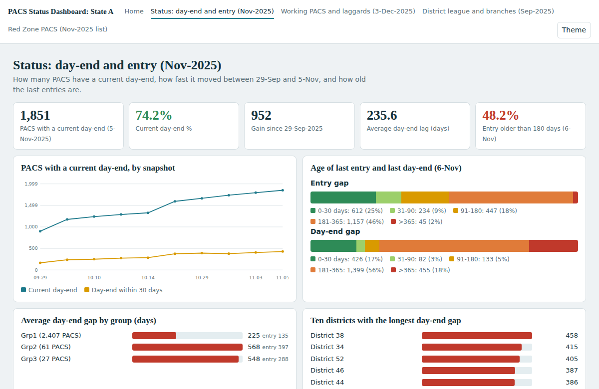
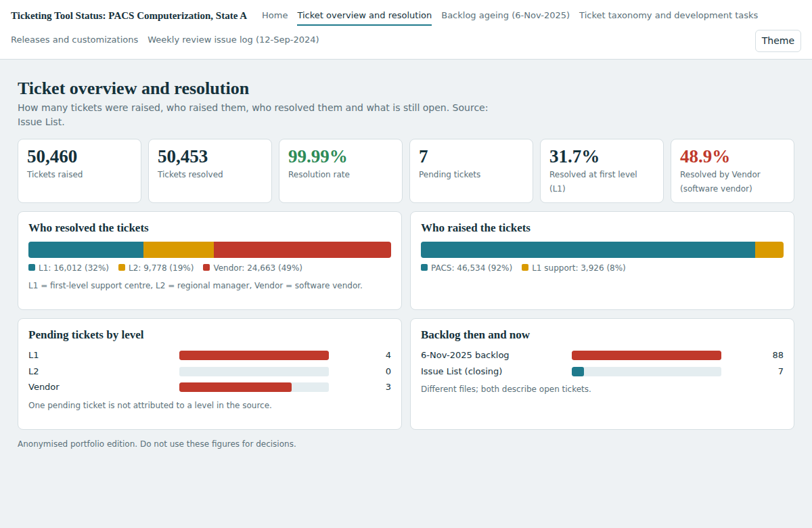
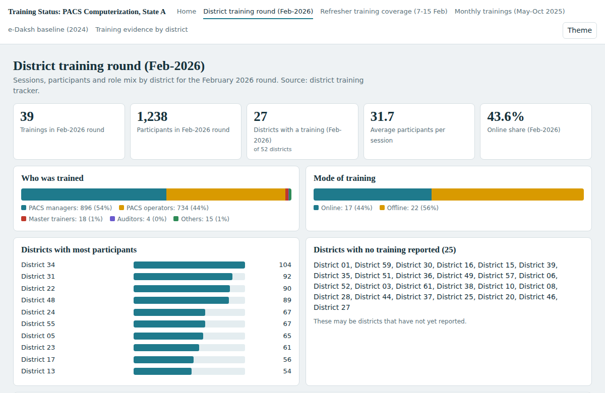
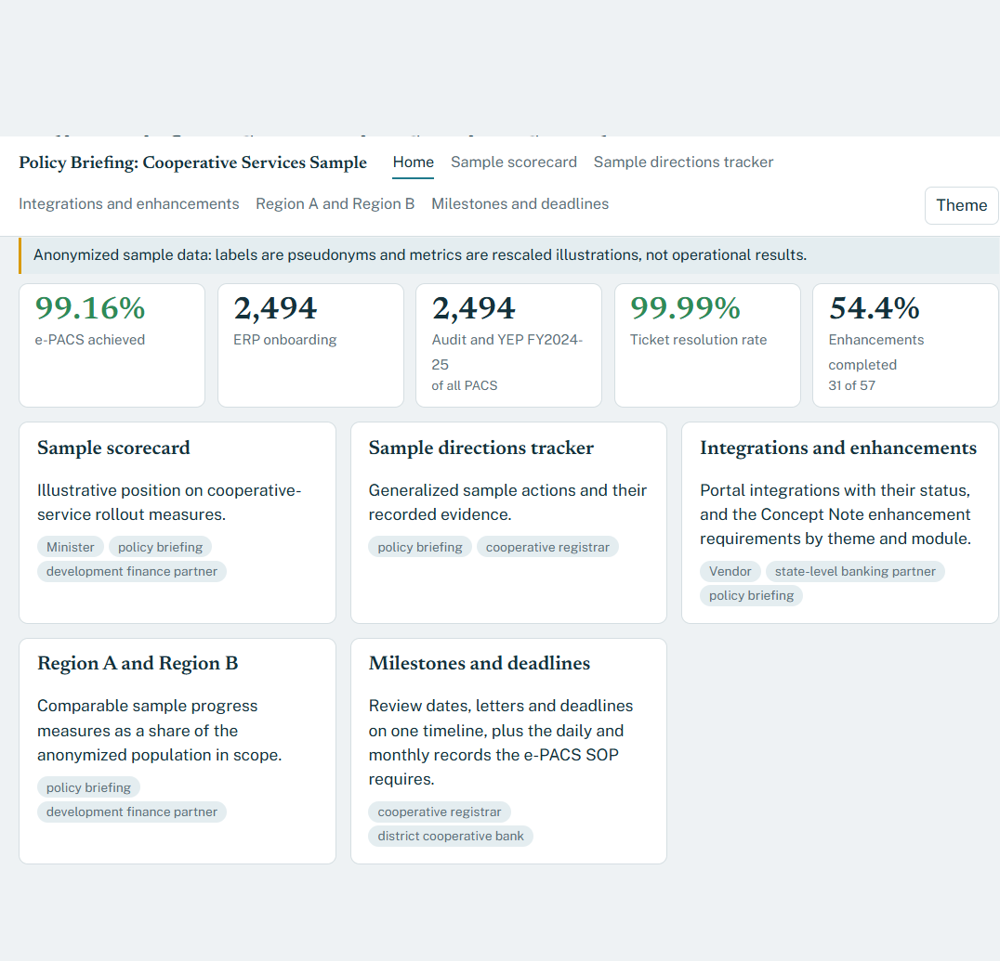
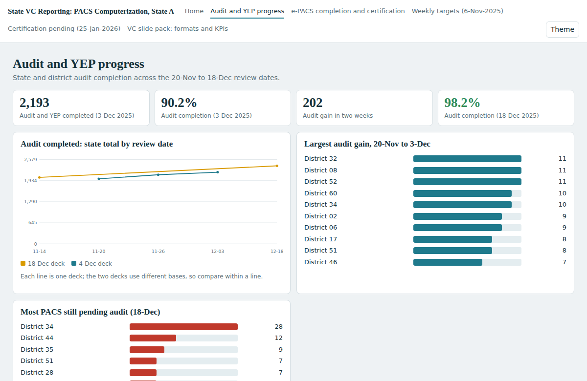

# Cooperative Reporting Portfolio: Anonymized Sample Edition

Five reporting demonstrations for a cooperative-services program: one KPI framework, a separate data model for each reporting area, and a dashboard for each stakeholder role. Each project contains a dashboard, its Python build script, a KPI dictionary, and a **Power BI kit** (data model, DAX, Power Query, theme, and report specification).

> **Sample data notice.** This is an anonymized, rescaled portfolio edition. Organization and stakeholder names have been generalized; district, branch, and bank labels are pseudonyms. The figures are illustrative examples based on reporting patterns, not current operational results, and must not be used for decisions. Original source documents, personal records, contact details, and credentials are excluded. Public release should follow the data owner's approval process.

**Live dashboards:** [cooperative-reporting-sample-portfolio](https://pradeep231790.github.io/cooperative-reporting-sample-portfolio/) (GitHub Pages from `main` / root).

## Catalogue

| Project | What it reports | Audience | Pages | KPIs |
|---|---|---|---|---|
| [PACS status](projects/pacs-status-dashboard/) | Operational status of every PACS: day-end currency, age of the last entry, working and laggard PACS, district league and branch drill-down, Red Zone list. | Collector, cooperative registrar, district cooperative bank | 4 | 10 |
| [Ticketing tool status](projects/ticketing-tool-status/) | Support tickets by level, backlog ageing, development tasks, release deployment and customization pipeline. | state-level banking partner, vendor, SI | 5 | 10 |
| [Training status](projects/training-status/) | Training reach by district, refresher-plan coverage, monthly sessions and a baseline round, with a documentation check. | cooperative registrar, development finance partner, state-level banking partner | 5 | 9 |
| [Policy briefing](projects/policy-briefing/) | A briefing pack: scorecard, generalized directions tracker, integrations, comparison, and milestone timeline. | policy team, development finance partner | 5 | 9 |
| [State VC reporting](projects/state-vc-reporting/) | The weekly video-conference review: audit and e-PACS progress, dated targets, weekly targets and certification pending. | cooperative registrar, development finance partner, audit dept | 5 | 9 |

## Screenshots

### PACS status
[](projects/pacs-status-dashboard/docs/index.html)

### Ticketing tool status
[](projects/ticketing-tool-status/docs/index.html)

### Training status
[](projects/training-status/docs/index.html)

### Policy briefing
[](projects/policy-briefing/docs/index.html)

### State VC reporting
[](projects/state-vc-reporting/docs/index.html)

## What each project demonstrates

- **Data engineering:** reconciling tabular source definitions, cleaning dates and labels, and reducing operational-level inputs to aggregated sample tables.
- **KPI design:** every KPI has a definition, formula, source, audience and a matching DAX measure (see each project's `docs-md/KPI_DICTIONARY.md`).
- **Dashboarding:** responsive HTML/SVG dashboards with sortable tables, heat colouring and dark mode, built from a small declarative spec (no framework, no server).
- **Power BI:** CSV model tables, `measures.dax`, a Power Query loader, `theme.json`, `MODEL.md` and a page-by-page `REPORT_SPEC.md`. A ready `.pbix` is not included, and the DAX has not been run in Power BI Desktop.
- **Documentation and governance:** methodology notes with assumptions, data dictionaries, and privacy by design.

## How a project is organised

```
projects/<name>/
  docs/          dashboard (open docs/index.html)
  data/processed anonymised aggregate tables
  powerbi/       model CSVs, measures.dax, powerquery_load.pq, theme.json, MODEL.md, REPORT_SPEC.md
  docs-md/       KPI dictionary, data dictionary, methodology
  src/           build.py and the shared scaffold
```

Rebuild a project: `cd projects/<name> && pip install -r requirements.txt && python src/build.py`.

## Author

Pradeep Mishra · [GitHub profile](https://github.com/pradeep231790)
